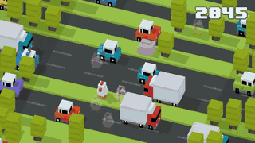
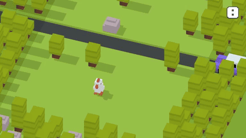
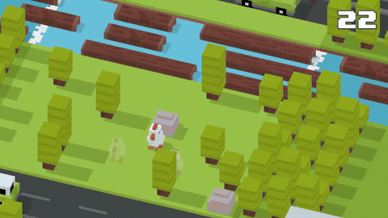
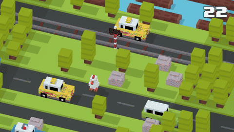
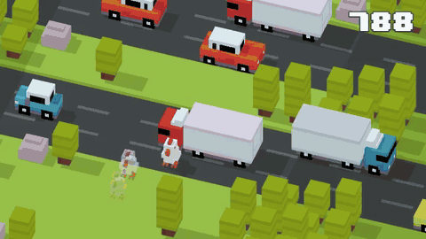
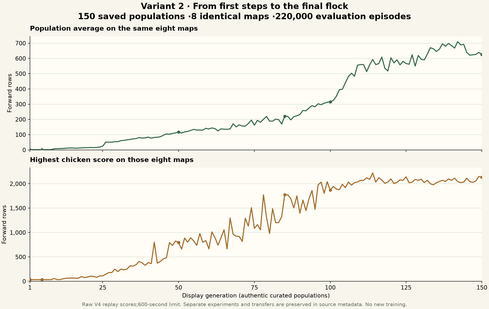
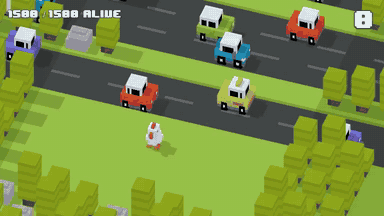
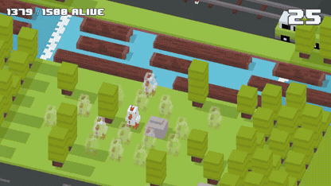

# Crossy Road AI

Training AI to play Crossy Road by evolving neural networks.

**[Visit the website](https://jeremyhua.ng/crossyroadai)** · **[Race against the AI](https://jeremyhua.ng/crossyroadai/play)** · **[Explore replays](https://jeremyhua.ng/crossyroadai/explore?variant=1)**

## Variant 1: Just cars and roads

[](https://jeremyhua.ng/crossyroadai/explore?variant=1)

[Full results and evaluation details for Variant 1](docs/variants/variant-1.md)

### Highlights

These clips show the entire saved population on one selected map. Chickens at the same position share a glyph: denser groups appear more opaque, and the largest groups are solid white. Open a replay to watch the full run, change its map, pause, scrub, or adjust playback speed.

| Generation | Preview | Description |
| --- | --- | --- |
| **[Gen 1: Random movement](https://jeremyhua.ng/crossyroadai/?generation=1&seed=561909326&variant=1)** | [](https://jeremyhua.ng/crossyroadai/?generation=1&seed=561909326&variant=1) | Randomly wired networks send chickens in different directions.<br>**High Score: 10** |
| **[Gen 5: Forward selection](https://jeremyhua.ng/crossyroadai/?generation=5&seed=627233379&variant=1)** | [](https://jeremyhua.ng/crossyroadai/?generation=5&seed=627233379&variant=1) | Movement is still scattered, but more and more chickens move forward.<br>**High Score: 34** |
| **[Gen 50: Traffic timing](https://jeremyhua.ng/crossyroadai/?generation=50&seed=346364751&variant=1)** | [](https://jeremyhua.ng/crossyroadai/?generation=50&seed=346364751&variant=1) | The chickens learn to time their moves around nearby traffic.<br>**High Score: 946** |
| **[Gen 85: Longer crossings](https://jeremyhua.ng/crossyroadai/?generation=85&seed=27099291&variant=1)** | [](https://jeremyhua.ng/crossyroadai/?generation=85&seed=27099291&variant=1) | The chickens learn to use traffic farther ahead when choosing a crossing.<br>**High Score: 4,140** |
| **[Gen 100: Action memory](https://jeremyhua.ng/crossyroadai/?generation=100&seed=27099291&variant=1)** | [](https://jeremyhua.ng/crossyroadai/?generation=100&seed=27099291&variant=1) | The chickens learn to use previous actions when choosing their next move.<br>**High Score: 9,520** |
| **[Gen 150: Final population](https://jeremyhua.ng/crossyroadai/?generation=150&seed=561909326&variant=1)** | [](https://jeremyhua.ng/crossyroadai/?generation=150&seed=561909326&variant=1) | The final saved population combines traffic lookahead and action memory.<br>**High Score: 13,639** |

## Variant 2: Cars, trains, and logs

[](https://jeremyhua.ng/crossyroadai/play?variant=2)

Variant 2 adds rivers, moving logs, lily pads, train crossings, and eagle pressure. Training is complete. The default final AI is one frozen ordinary-input neural network, used on every race seed.

On **256 opened development maps**, this policy averages **763.05 rows**, with its own maximum of **2,082**. A separate policy reached **2,296**, averaging **517.71** on that suite. Those are two different brains. No independent final assessment is claimed; all 512 reserved final maps remain unopened. The 1,000-average goal was not reached.

[Explore Variant 2](https://jeremyhua.ng/crossyroadai/explore?variant=2) · [Race the final AI](https://jeremyhua.ng/crossyroadai/play?variant=2) · [All generation scores](https://jeremyhua.ng/crossyroadai/variant-2/replay-audit.html) · [Methods and provenance](docs/variants/variant-2-showcase.md)

### Highlights

The six clips show authentic complete saved populations. GIFs run at 1×; later clips are 15-second excerpts. Each **High Score** is the whole population’s actual maximum on the linked map, rather than the final AI’s benchmark score.

| Generation | Replay at 1× | What changes |
| --- | --- | --- |
| **[Gen 1: Random movement](https://jeremyhua.ng/crossyroadai/?generation=1&seed=561909326&variant=2)** | [](https://jeremyhua.ng/crossyroadai/?generation=1&seed=561909326&variant=2) | Random networks meet roads, rivers, and train crossings.<br>**High Score: 9** |
| **[Gen 5: Forward selection](https://jeremyhua.ng/crossyroadai/?generation=5&seed=627233379&variant=2)** | [](https://jeremyhua.ng/crossyroadai/?generation=5&seed=627233379&variant=2) | Early selection favors useful forward movement.<br>**High Score: 13** |
| **[Gen 50: River crossings](https://jeremyhua.ng/crossyroadai/?generation=50&seed=346364751&variant=2)** | [](https://jeremyhua.ng/crossyroadai/?generation=50&seed=346364751&variant=2) | Transferred road skills adapt to moving support and river hazards.<br>**High Score: 300** |
| **[Gen 85: Consistent crossings](https://jeremyhua.ng/crossyroadai/?generation=85&seed=27099291&variant=2)** | [](https://jeremyhua.ng/crossyroadai/?generation=85&seed=27099291&variant=2) | The population handles changing traffic, train warnings, and logs.<br>**High Score: 1,487** |
| **[Gen 100: Longer journeys](https://jeremyhua.ng/crossyroadai/?generation=100&seed=27099291&variant=2)** | [](https://jeremyhua.ng/crossyroadai/?generation=100&seed=27099291&variant=2) | Native networks travel farther through the full world.<br>**High Score: 1,643** |
| **[Gen 150: Final population](https://jeremyhua.ng/crossyroadai/?generation=150&seed=561909326&variant=2)** | [](https://jeremyhua.ng/crossyroadai/?generation=150&seed=561909326&variant=2) | The original population containing the frozen final AI.<br>**High Score: 1,969** |

### From first steps to the final flock



Display generations **1–150** condense authentic saved populations from separate scratch, transfer, river-adaptation, and native-input experiments. They are presentation positions, not 150 uninterrupted training generations. Original source generations, every genome, population hashes, transfers, and the historical cohort reset remain recorded. No networks or scores were interpolated.

Every saved chicken was audited on the same eight maps under frozen V4 rules: **220,000 evaluation episodes, zero new training**. The curve retains measured plateaus and regressions. It measures whole populations on the viewing panel, separately from the selected final AI’s 256-map development result. Advanced Replay offers all 150 positions and any uint32 map seed.

## Variant 3: Speedruns (Coming soon?)

Reach 100, 500, or 1,000 rows, or collect 10, 50, or 100 coins, as fast as possible, with time penalties for deaths.

## The experiment

### Choosing a move

1. **Read the surroundings.** Each chicken receives numerical observations of nearby tiles, obstacles, traffic positions, and movement. Variant 2 also supplies train warnings and information about support from logs or lily pads. Later Variant 1 phases add traffic lookahead and previous-action context.
2. **Choose an action.** A neural network assigns a score to each of five actions: wait, forward, backward, left, and right. The highest output selects the next action.
3. **Run the decision.** Traffic and floating objects continue moving while the action executes. The simulation checks the jump path and landing for collisions, then supplies updated observations for the next decision.

### Training a population

1. **Population and maps.** The completed Variant 1 memory phase evaluates **100 chickens on 32 randomly generated maps per generation**. Every chicken faces the same maps within that generation, and map panels change between generations. Earlier runs used up to 200 chickens on smaller map panels to try more networks with less evaluation per network. Variant 2’s final batches evaluated 200 chickens on 64 changing maps per generation; training has now stopped.
2. **Reward forward progress.** A chicken’s game score is its furthest row before death or timeout. The final Variant 1 run ranks networks by their average score across the 32 maps. Other experiments also test consistency-sensitive selection; their fitness definitions and results stay separate.
3. **Breed and change.** NEAT—NeuroEvolution of Augmenting Topologies—selects successful networks as parents, crosses over their connections, mutates weights, and can add neurons or connections. Species group related networks so new structures can develop. The next population plays another set of evaluations.

The simulation and neural decisions run independently of the Three.js renderer. Replays load saved networks and resimulate them on a deterministic map; they do not retrain networks or change their weights. Development maps help select candidates, while separately reserved maps assess a frozen final policy.

## The entire bloodline (10 chickens from each generation)

Ten saved networks from each of the 150 curated display generations run together on one map: **1,500 chickens**. The GIF loops the full score 0–100 run at normal speed.

[](https://jeremyhua.ng/crossyroadai/#crowd-title)

[](https://jeremyhua.ng/crossyroadai/#crowd-title)

Each variant mixes ten unchanged saved networks from every one of its 150 display generations: 1,500 chickens on the same map. These clips preserve the original networks and source manifests; they do not reconstruct parent–child relationships.

## Run locally

Use Node 24 LTS. Install dependencies and fetch the pinned original visual assets:

```bash
npm ci
npm run setup:assets
npm run dev
```

Open the Local URL printed by Vite, normally `http://127.0.0.1:5173`.

| Page | Local URL |
| --- | --- |
| Homepage | `/` |
| Variant 1 replay chooser | `/explore?variant=1` |
| Variant 2 replay chooser | `/explore?variant=2` |
| Saved generation and map | `/?generation=150&seed=561909326&variant=1` |
| Race setup | `/play` |
| Original Variant 1 neural-network and graph inspector | `/lab/variant-1` |
| Original Variant 2 development visualizer | `/?variant=2` |

Replay URLs use query parameters for the generation, seed, and variant. The chooser shows six highlights first; Advanced replay exposes specific generations and available map seeds. Historical phase-qualified and older path links remain supported.

The hosted website includes the populations used by its replay menus. Local regeneration requires the matching saved training archives; see [explorer data](docs/explorer.md), [homepage previews](docs/homepage-previews.md), and the [data guide](docs/DATA_RELEASE.md).

```bash
npm test
npm run build
```

## Results and data

- [Completed Variant 1 results](docs/variants/variant-1.md), [frozen evaluation](results/variants/variant-1/final/evaluation.json), and [verification](results/variants/variant-1/final/verification.json).
- [Historical learning milestones and population-size comparison](docs/variants/variant-1-highlights.md).
- [Variant 2 development results and experiments](docs/variants/variant-2.md) and [recovered decisions and training history](docs/variants/variant-2-recovery.md).
- [Training-data guide](docs/DATA_RELEASE.md), [technical archive](docs/VARIANT_1_TECHNICAL_ARCHIVE.md), and [Variant 1 research log](docs/variants/variant-1-research-log.md).

## Credits

The visual layer uses original assets and source adaptations from [Evan Bacon’s Expo-Crossy-Road](https://github.com/EvanBacon/Expo-Crossy-Road). The README GIFs are recorded gameplay excerpts from this project. [Attribution and retained license notices](docs/ATTRIBUTION.md) · [GIF sources](docs/media/README.md).
