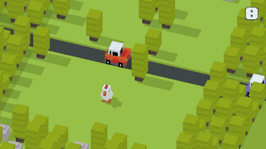
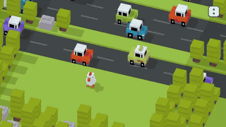
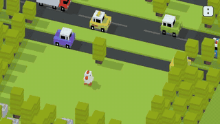
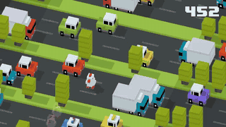
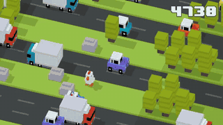
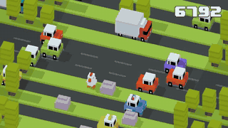
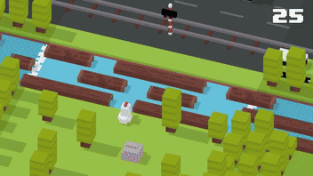
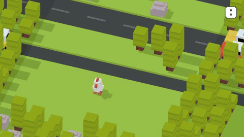
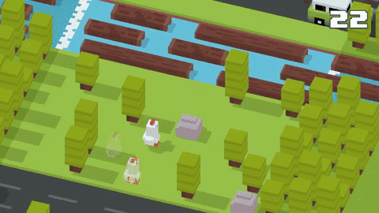

# Crossy Road AI

**Teaching the chicken to cross the road.**

An interactive machine learning experiment that teaches AI to play Crossy Road through neuroevolution. Watch neural networks evolve from random movement to navigating traffic, trains, and rivers over hundreds of generations. Or race against the AI yourself!

Inspired by [Trackmania AI experiments](https://www.youtube.com/watch?v=Dw3BZ6O_8LY) and [Code Bullet’s AI projects](https://www.youtube.com/@CodeBullet).

**[Click for some cool visualizations!](https://crossyroadai.com)** · **[Race against the AI](https://crossyroadai.com/play)** · **[Explore replays](https://crossyroadai.com/explore?variant=1)**

## Variant 1: Just cars and roads

[](https://crossyroadai.com/explore?variant=1)

[Full results and evaluation details for Variant 1](docs/results/variant-1.md)

### Highlights

These clips show the entire saved population on one selected map. Chickens at the same position share a glyph: denser groups appear more opaque, and the largest groups are solid white. Open a replay to watch the full run, change its map, pause, scrub, or adjust playback speed.

<table width="100%">
  <tr>
    <th width="30%">Generation</th>
    <th width="42%">Preview</th>
    <th width="28%">Description</th>
  </tr>
  <tr>
    <td><strong><a href="https://crossyroadai.com/?generation=1&amp;seed=561909326&amp;variant=1">Gen 1: Random movement</a></strong></td>
    <td><a href="https://crossyroadai.com/?generation=1&amp;seed=561909326&amp;variant=1"></a></td>
    <td>Randomly wired networks send chickens in different directions.<br><br><strong>High Score: 10</strong></td>
  </tr>
  <tr>
    <td><strong><a href="https://crossyroadai.com/?generation=5&amp;seed=627233379&amp;variant=1">Gen 5: Forward selection</a></strong></td>
    <td><a href="https://crossyroadai.com/?generation=5&amp;seed=627233379&amp;variant=1"></a></td>
    <td>Movement is still scattered, but more and more chickens move forward.<br><br><strong>High Score: 34</strong></td>
  </tr>
  <tr>
    <td><strong><a href="https://crossyroadai.com/?generation=50&amp;seed=346364751&amp;variant=1">Gen 50: Traffic timing</a></strong></td>
    <td><a href="https://crossyroadai.com/?generation=50&amp;seed=346364751&amp;variant=1"></a></td>
    <td>The chickens learn to time their moves around nearby traffic.<br><br><strong>High Score: 946</strong></td>
  </tr>
  <tr>
    <td><strong><a href="https://crossyroadai.com/?generation=85&amp;seed=27099291&amp;variant=1">Gen 85: Longer crossings</a></strong></td>
    <td><a href="https://crossyroadai.com/?generation=85&amp;seed=27099291&amp;variant=1"></a></td>
    <td>The chickens learn to use traffic farther ahead when choosing a crossing.<br><br><strong>High Score: 4,140</strong></td>
  </tr>
  <tr>
    <td><strong><a href="https://crossyroadai.com/?generation=100&amp;seed=27099291&amp;variant=1">Gen 100: Action memory</a></strong></td>
    <td><a href="https://crossyroadai.com/?generation=100&amp;seed=27099291&amp;variant=1"></a></td>
    <td>The chickens learn to use previous actions when choosing their next move.<br><br><strong>High Score: 9,520</strong></td>
  </tr>
  <tr>
    <td><strong><a href="https://crossyroadai.com/?generation=150&amp;seed=561909326&amp;variant=1">Gen 150: Final population</a></strong></td>
    <td><a href="https://crossyroadai.com/?generation=150&amp;seed=561909326&amp;variant=1"></a></td>
    <td>The final saved population combines traffic lookahead and action memory.<br><br><strong>High Score: 13,639</strong></td>
  </tr>
</table>

## Variant 2: Cars, trains, and logs

[](https://crossyroadai.com/play?variant=2)

[Full results and evaluation details for Variant 2](docs/results/variant-2.md)

### Highlights

The six clips show authentic complete saved populations. GIFs run at 1×; later clips show 15 seconds around the early train and log crossings. Each **High Score** is the whole population’s actual maximum on the linked map, rather than the final AI’s benchmark score.

<table width="100%">
  <tr>
    <th width="30%">Generation</th>
    <th width="42%">Preview</th>
    <th width="28%">Description</th>
  </tr>
  <tr>
    <td><strong><a href="https://crossyroadai.com/?generation=1&amp;seed=318&amp;variant=2">Gen 1: Random movement</a></strong></td>
    <td><a href="https://crossyroadai.com/?generation=1&amp;seed=318&amp;variant=2"></a></td>
    <td>Chickens move in random directions.<br><br><strong>High Score: 13</strong></td>
  </tr>
  <tr>
    <td><strong><a href="https://crossyroadai.com/?generation=5&amp;seed=4984&amp;variant=2">Gen 5: Forward selection</a></strong></td>
    <td><a href="https://crossyroadai.com/?generation=5&amp;seed=4984&amp;variant=2"></a></td>
    <td>Early selection starts to favor chickens that keep moving forward.<br><br><strong>High Score: 26</strong></td>
  </tr>
  <tr>
    <td><strong><a href="https://crossyroadai.com/?generation=50&amp;seed=318&amp;variant=2">Gen 50: River crossings</a></strong></td>
    <td><a href="https://crossyroadai.com/?generation=50&amp;seed=318&amp;variant=2"></a></td>
    <td>Road skills develop, but river crossings are still tricky.<br><br><strong>High Score: 275</strong></td>
  </tr>
  <tr>
    <td><strong><a href="https://crossyroadai.com/?generation=85&amp;seed=14232&amp;variant=2">Gen 85: Consistent crossings</a></strong></td>
    <td><a href="https://crossyroadai.com/?generation=85&amp;seed=14232&amp;variant=2"></a></td>
    <td>The chickens combine signals to cross train tracks and logs more consistently.<br><br><strong>High Score: 989</strong></td>
  </tr>
  <tr>
    <td><strong><a href="https://crossyroadai.com/?generation=100&amp;seed=4984&amp;variant=2">Gen 100: Longer journeys</a></strong></td>
    <td><a href="https://crossyroadai.com/?generation=100&amp;seed=4984&amp;variant=2"></a></td>
    <td>The chickens build on earlier skills for longer, more consistent crossings.<br><br><strong>High Score: 1,454</strong></td>
  </tr>
  <tr>
    <td><strong><a href="https://crossyroadai.com/?generation=150&amp;seed=318&amp;variant=2">Gen 150: Final population</a></strong></td>
    <td><a href="https://crossyroadai.com/?generation=150&amp;seed=318&amp;variant=2"></a></td>
    <td>The final saved population combines traffic timing, train warnings, and log crossings.<br><br><strong>High Score: 2,063</strong></td>
  </tr>
</table>

## Variant 3: Speedruns (Coming soon?)

Reach 100, 500, or 1,000 rows, or collect 10, 50, or 100 coins, as fast as possible, with time penalties for deaths.

## The experiment

### Choosing a move

1. **Read the surroundings.** Each chicken receives numerical observations of nearby tiles, obstacles, traffic positions, and movement. Variant 2 also supplies train warnings and information about support from logs or lily pads. Later Variant 1 phases add traffic lookahead and previous-action context.
2. **Choose an action.** A neural network assigns a score to each of five actions: wait, forward, backward, left, and right. The highest output selects the next action.
3. **Run the decision.** Traffic and floating objects continue moving while the action executes. The simulation checks the jump path and landing for collisions, then supplies updated observations for the next decision.

### Training a population

1. **Population and maps.** The completed Variant 1 memory phase evaluates **100 chickens on 32 randomly generated maps per generation**. Every chicken faces the same maps within that generation, and map panels change between generations. Earlier runs used up to 200 chickens on smaller map panels to try more networks with less evaluation per network. Variant 2’s final batches evaluated 200 chickens on 64 changing maps per generation; training has now stopped.
2. **Reward forward progress.** A chicken’s game score is its furthest row before death or timeout. The final Variant 1 run ranks networks by their average score across the 32 maps. Other experiments also test consistency-sensitive selection; their fitness definitions and results stay separate.
3. **Breed and change.** NEAT—NeuroEvolution of Augmenting Topologies—selects successful networks as parents, crosses over their connections, mutates weights, and can add neurons or connections. Species group related networks so new structures can develop. The next population plays another set of evaluations.

The simulation and neural decisions run independently of the Three.js renderer. Replays load saved networks and resimulate them on a deterministic map; they do not retrain networks or change their weights. Development maps help select candidates, while separately reserved maps assess a frozen final policy.

## The entire bloodline (10 chickens from each generation)

Ten saved networks from each of the 150 display generations run together on one map: **1,500 chickens**. The Variant 1 GIF loops score 0–100 at normal speed.

<table>
  <tr>
    <th width="50%">Variant 1</th>
    <th width="50%">Variant 2</th>
  </tr>
  <tr>
    <td><a href="https://crossyroadai.com/#crowd-title"></a></td>
    <td><a href="https://crossyroadai.com/#crowd-title"></a></td>
  </tr>
</table>

Each variant mixes ten unchanged saved networks from every one of its 150 display generations: 1,500 chickens on the same map. The Variant 2 clip uses map 318, starting around row 25: logs begin at row 26, trains at row 31, and there are no lily-pad rows through row 150. The camera follows the largest group within ten rows of the living front, keeping that group solid white. These clips preserve the original networks and source manifests.

## Run locally

Use Node 24 LTS. Install dependencies and fetch the pinned original visual assets:

```bash
npm ci
npm run setup:assets
npm run dev
```

Open the Local URL printed by Vite, normally `http://127.0.0.1:5173`.

| Page | Local URL |
| --- | --- |
| Homepage | `/` |
| Variant 1 replay chooser | `/explore?variant=1` |
| Variant 2 replay chooser | `/explore?variant=2` |
| Saved generation and map | `/?generation=150&seed=561909326&variant=1` |
| Race setup | `/play` |
| Original Variant 1 neural-network and graph inspector | `/lab/variant-1` |
| Original Variant 2 development visualizer | `/?variant=2` |

Replay URLs use query parameters for the generation, seed, and variant. The chooser shows six highlights first; Advanced replay exposes specific generations and available map seeds. Historical phase-qualified and older path links remain supported.

The hosted website includes the saved populations used by both replay menus. See the [development guide](docs/README.md) for code layout, replay data, media exports and deployment.

```bash
npm test
npm run build
```

## Results and data

- **[Variant 1: learning to read traffic](docs/results/variant-1.md)** — the 512-map held-out assessment, baseline comparisons, input ablation and replay measurements. [Data](results/variant-1/).
- **[Variant 2: traffic, trains and moving water](docs/results/variant-2.md)** — the two frozen policies, development-map distributions, final continuation study and replay measurements. [Data](results/variant-2/).

## Repository guide

| Path | Contents |
| --- | --- |
| [src/](src/) | Simulation, neural networks and website |
| [scripts/](scripts/) | Training, evaluation, export and media tools |
| [public/training-cohorts/](public/training-cohorts/) | Saved populations, organized by variant |
| [results/](results/) | Final evaluations and comparison data, organized by variant |
| [docs/](docs/README.md) | Development guide, results reports and figures |

## Credits

The visual layer uses original assets and source adaptations from [Evan Bacon’s Expo-Crossy-Road](https://github.com/EvanBacon/Expo-Crossy-Road). The README GIFs are recorded gameplay excerpts from this project. [Attribution and retained license notices](docs/ATTRIBUTION.md) · [GIF sources](docs/media/README.md).

Independent educational AI project. Not affiliated with, sponsored by, or endorsed by Hipster Whale. Crossy Road is a trademark of Hipster Whale Pty Ltd.
