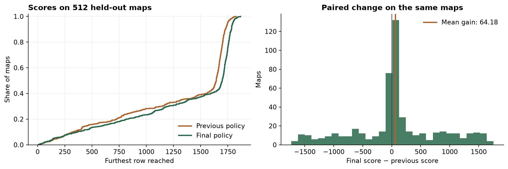
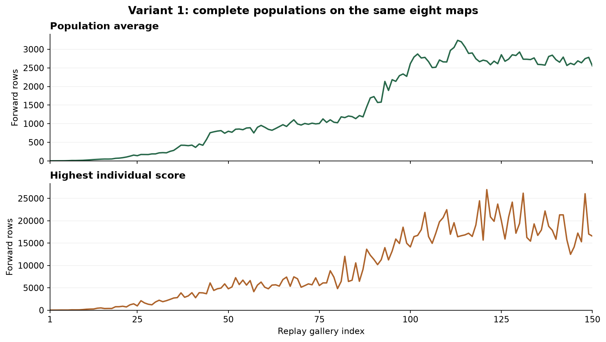

# Variant 1: learning to read traffic

The final network averages **1,361.21 rows on 512 held-out maps**. It reaches row 1,000 on **392 maps (76.56%)**, with a median of **1,697** and a best score of **1,867**. Training is complete.

The main result is a single frozen policy, not the best chicken chosen separately for each map. Its development score was 1,393.31 across 768 maps. The 512-map closing assessment happened after selection and freezing.

[Watch the replays](https://jeremyhua.ng/crossyroadai/explore?variant=1) · [Race the AI](https://jeremyhua.ng/crossyroadai/play?variant=1) · [Evaluation data](../../results/variant-1/final/evaluation.json)

## The task

A chicken must cross a succession of roads without hitting traffic or leaving the board. Its score is the furthest row reached. At every decision, a neural network chooses wait, forward, backward, left, or right from numerical observations of the surrounding world.

The closing benchmark uses 600-second episodes, difficulty 1, no more than three consecutive road lanes, and three vehicles per road. It retains the original eagle-free rules of the saved experiment. The website's current manual-play rules are separate.

NEAT evolves both connection weights and network structure. Later experiments add motion information, traffic lookahead and previous-action context. The final phase uses 100 chickens on 32 changing training maps per generation; it contributes 480,000 training episodes. Earlier populations and warm starts remain in the archive.

## Closing results

Every policy in this table faces the same 512 maps and episode limit.

| Policy | Average rows |
| --- | ---: |
| Random actions | 0.97 |
| Simple traffic rule | 13.08 |
| Distance-based rule | 111.97 |
| Previous published network | 1,297.03 |
| Final network | **1,361.21** |

The final network gains **64.18 rows per map** over the previous release. The paired 95% map-bootstrap interval is **0.31–129.60**. Its own mean has a 95% map-bootstrap interval of **1,313.32–1,409.09**. These intervals describe variation over maps for these fixed policies; they do not establish how reliably a fresh training run would reproduce the result.

Removing traffic-position and proximity inputs from the frozen network reduces its average to **5.36**. This ablation changes the observations supplied to an already selected network. It supports that the network responds to learned traffic information, rather than simply moving forward regardless of its surroundings.

## Did a larger population help?

One matched-budget comparison starts from the same 1,304.71-average parent. Both branches run 50 generations and 160,000 training episodes, with the same mutation settings and development shortlist size.

| Population × maps | Training episodes | Selected generation | Development average |
| --- | ---: | ---: | ---: |
| 100 × 32 | 160,000 | 45 | 1,315.76 |
| 200 × 16 | 160,000 | 40 | 1,307.56 |

The smaller population scores 8.20 rows higher in this pair. A larger population gives more candidate networks but fewer maps per candidate at the same budget. It does not automatically improve selection.

This is one comparison, with different subsequent random-map panels and RNG consumption. It is not evidence that 100 chickens are generally better than 200. Both figures are development-selection scores, separate from the closing held-out assessment.

Sources: [100-chicken run](../../results/variant-1/comparisons/population-100.json), [200-chicken run](../../results/variant-1/comparisons/population-200.json).

## What the replay gallery measures

This figure evaluates every member of each gallery population on the same eight viewing maps. It shows measured population averages and maxima, including regressions. It is not a curve of the final policy's held-out test score.

The gallery's 1–150 labels index saved populations across the prototype, binary-input, motion, lookahead and memory phases. Source generations and population hashes are retained in the [sequence data](../../results/variant-1/replays/sequence.json). The selected warm-start chain spans 1,174 phase-generation positions, with crossover and several continuations; the labels do not claim one uninterrupted 150-generation training run.

Full viewing replays can continue beyond the historical benchmark cutoff. This is why an illustrative gallery high score can exceed the best 600-second test score. The README clips are selected excerpts; the website offers complete replays and arbitrary map seeds.

## Verification and limits

- The selected checkpoint was frozen before the closing assessment and verified unchanged afterward.
- Saved replay networks are checked against their original full-population archives.
- Headless and rendered replays use the same simulation and neural decisions.
- The earlier FA holdout remains unopened. It was not needed for this closing assessment.
- The results describe one selected policy and a finite map distribution, not guaranteed play on every possible seed.

[Freeze](../../results/variant-1/final/freeze.json) · [Verification and interval](../../results/variant-1/final/verification.json) · [Replay verification](../../results/variant-1/final/replay-verification.json) · [Training lineage](../../results/variant-1/training-lineage.json) · [Per-gallery-map scores](../../results/variant-1/replays/maps.csv)
