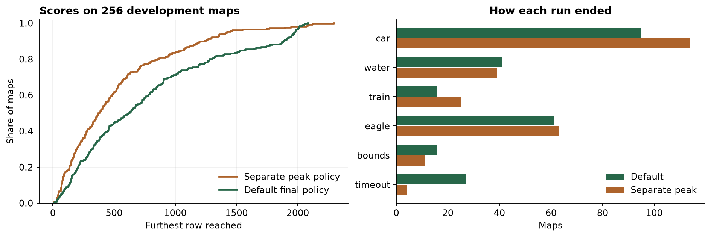
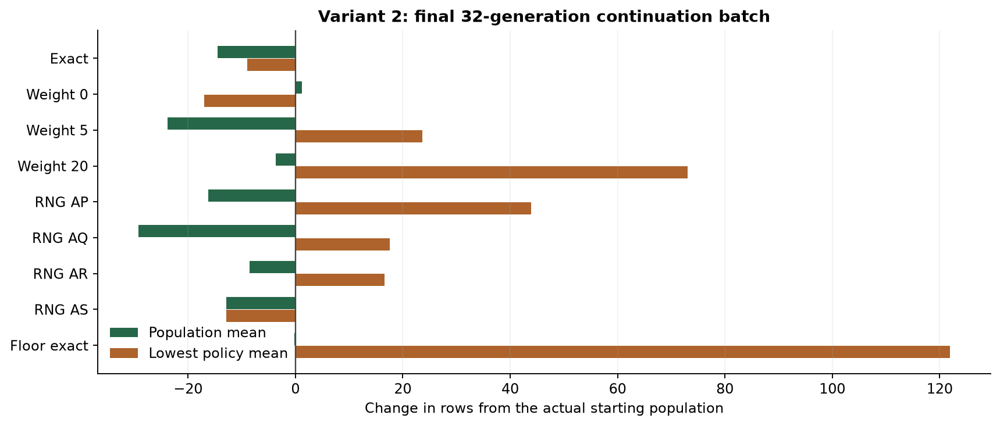
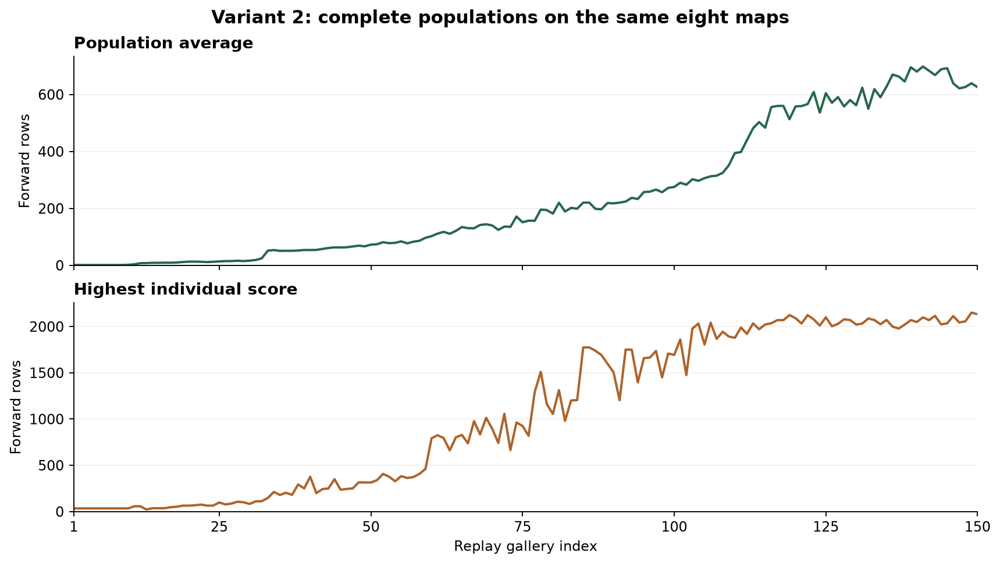

# Variant 2: traffic, trains and moving water

The frozen default network averages **763.05 rows on 256 development maps**, with its own best score of **2,082**. A separate network reaches **2,296**, but averages **517.71** on the same maps. The higher maximum comes with less consistent performance.

Training is complete. The 1,000-average target was not reached. These are development-selection results, not an independent final-test result; **all 512 reserved final maps remain unopened**.

[Watch the replays](https://jeremyhua.ng/crossyroadai/explore?variant=2) · [Race the final AI](https://jeremyhua.ng/crossyroadai/play?variant=2) · [Default-policy evaluation](../../results/variant-2/final/main/evaluation.json)

## What changed from Variant 1

The chicken now has to combine road traffic with train warnings, moving logs and lily-pad support. Waiting can be useful, but a log continues drifting while the chicken waits. Reaching no new highest row for ten simulated seconds ends a run with an eagle capture.

The final rules use 60 Hz simulation, six neural decisions per second and a 600-second episode limit. The network receives ordinary native V9 observations and chooses every action. Fixed training labels contribute to fitness and diagnostics; they do not provide actions, forecasts or a controller during play.

Human races and the AI use the same generated map and seed. The opponent is one frozen network on every seed. Changing the seed does not select a more successful network for that map.

## Two policies, two tradeoffs

| Development result, 256 maps | Default final AI | Separate peak policy |
| --- | ---: | ---: |
| Average rows | **763.05** | 517.71 |
| Median rows | **621.5** | 375.5 |
| Highest score | 2,082 | **2,296** |
| Reach row 1,000 | **28.91%** | 16.41% |
| Survive to the time limit | **10.55%** | 1.56% |
| Genome | 353089 | 319474 |

The default policy's higher average does not mean it handles every map better. The distributions overlap, and both networks still fail on roads, water and trains. Road collisions account for 95 of the default policy's 256 outcomes; eagle captures account for 61. A few long runs are not enough to establish consistent survival.

The default is the network selected from original continuation019, native generation 392. The separate peak belongs to original continuation013, native generation 224. Their means and maxima are always reported separately. Later descendants inheriting a cached winner do not count as new learning of that winner.

Sources: [default outcomes](../../results/variant-2/final/main/evaluation.json), [peak outcomes](../../results/variant-2/final/peak/evaluation.json), [policy freeze](../../results/variant-2/final/policy-freeze.json), [lineage verification](../../results/variant-2/final/main/lineage-verification.json).

## What the final training batch showed

The last batch contains nine 32-generation continuations, ending at native generation 448. Each retains its parent population and evolution state, adding **409,600 gameplay episodes**; the batch adds **3,686,400**. Eight branches share the record-source parent, while one retains a complementary population with a stronger minimum policy score.

All 200 policies at each endpoint are evaluated on the same 64 development maps. This is **115,200 endpoint evaluation episodes**, reusing two actual starting-population evaluations totaling 25,600 episodes. The starting comparison uses the first populations actually evaluated at generation 417, rather than the previously evaluated parent at 416.

Only the weight-0 branch improves the population mean, by **1.22 rows**, while its lowest policy mean falls by **17.00**. None of the nine branches improves both measures. The complementary floor branch raises its minimum by 121.92 rows but slightly lowers its mean. The default-policy record remains 763.05.

This distinction matters: preserving a strong individual is different from improving a whole population. These continuations do not establish a general benefit from a particular critical-fitness weight or RNG stream. Shared ancestry, selection on development data and different future map streams limit causal conclusions.

[Final-batch data](../../results/variant-2/studies/continuation-416-448/comparison.json) · [Compact comparison CSV](../../results/variant-2/studies/final-batch.csv)

## Reading the replay gallery

The common-map figure covers **26,800 saved chickens and 214,400 population-map measurements**. Every gallery population faces the same eight maps under the final V4 viewing rules. It retains measured plateaus and regressions. No weights or scores are interpolated.

The gallery's 1–150 labels index complete saved populations from several experiments and transfers. They are display positions rather than one uninterrupted native training timeline. The [sequence data](../../results/variant-2/replays/sequence.json) and [source manifest](../../public/variant-2/showcase-provenance.json) retain original runs, native generations, member IDs and hashes. The historical selected-cohort restart remains part of the recorded ancestry.

The highlights use maps chosen for early logs and trains, with no lily-pad rows through row 150. Their highs are illustrative whole-population results on those selected maps:

| Gallery position | Map seed | Population high |
| --- | ---: | ---: |
| 1 | 318 | 13 |
| 5 | 4,984 | 26 |
| 50 | 318 | 275 |
| 85 | 14,232 | 989 |
| 100 | 4,984 | 1,454 |
| 150 | 318 | 2,063 |

These selected-map highs are not the final AI's development average or a controlled learning-rate estimate. The common eight-map measurements above provide a consistent population comparison. The final race opponent remains fixed regardless of which gallery highlights are shown.

## Verification and remaining limits

The published default and peak policies each have canonical 256-map traces, a replay of their actual maximum-scoring game, exact full-population membership checks, and comparison against their own starting genotypes. Existing verification results are preserved; presentation exports do not retrain networks or rerun those record proofs.

The site validates archive hashes before loading populations. Replay and race tests check identical AI actions and world states. Log-drift animation is separate from physics: standing still on a log carries the chicken sideways without repeatedly animating a jump.

The reserved final maps were not opened to choose the policy, tune the gallery or select attractive footage. The published numbers should therefore be read as development results with selection exposure. There is no independent final generalization claim for Variant 2.

[Per-gallery-map scores](../../results/variant-2/replays/maps.csv) · [Population summaries](../../results/variant-2/replays/generations.csv) · [Published-record verification](../../results/variant-2/final/main/publication-verification.json) · [Data layout](../../results/README.md)
