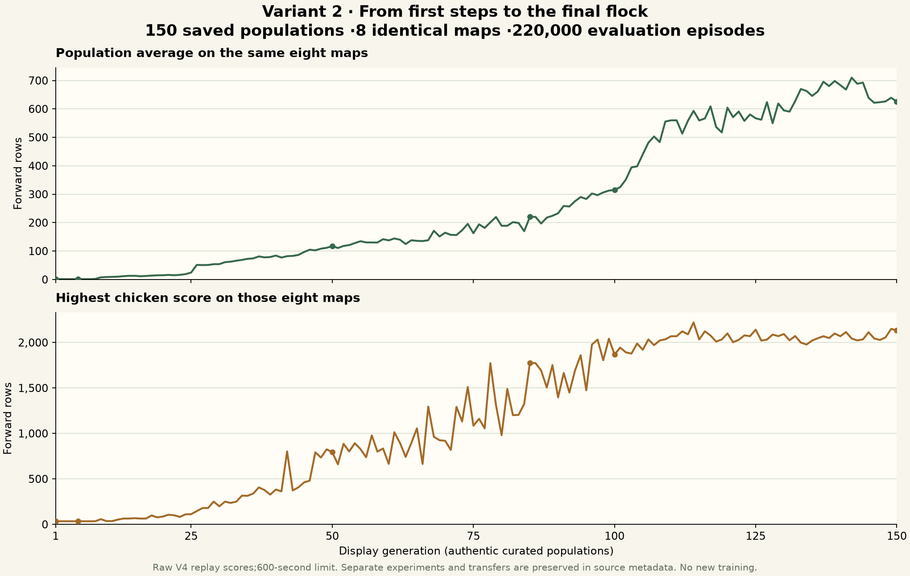

# Variant 2: the final showcase

Training ended on November 24, 2026, after all nine original native020 runs reached their generation 448 caps. Their original monitors, population comparison, and final nomination audit068 completed. No further training or evolutionary search is scheduled.

The website presents 150 authentic saved populations, real hover videos, six normal-speed highlight GIFs, a separate 1,500-chicken population mix, an advanced replay explorer, and races against one frozen final AI. [Explore](https://jeremyhua.ng/crossyroadai/explore?variant=2) · [Race](https://jeremyhua.ng/crossyroadai/play?variant=2) · [Common-map audit](https://jeremyhua.ng/crossyroadai/variant-2/replay-audit.html).

## Frozen policies and results

The default final AI is genome 353089 from **original native019 record-source generation 392**. It averages **763.046875 rows** on the already opened 256-map development suite, with its own maximum **2,082**. Its exact native confirmation, actual maximum replay, all 200 viewer genomes, and exclusion against all 200 own initial384 genotypes were verified before freezing. These existing proofs were reused rather than rerun.

The separate peak policy is genome 319474 from original native013 RNG-O generation 224: **517.7109375 average / 2,296 maximum** on that suite. Its maximum is not combined with the default policy’s average. Both policies and all historical records remain preserved.

These are development-selection results. No independent final score is claimed, and all 512 reserved final maps remain unopened. The 1,000-average objective was not achieved. The race opponent is a fixed network on every map seed, rather than a policy selected for that seed.

Freeze: `results/variants/variant-2/showcase-final-policy-freeze-001.json`. Public deployment: `public/variant-2/final-policy.json`. Original immutable proofs remain in their source directories. Original native019392 remains the record’s attribution even though later native020 populations inherited its cached best.

## Display generations 1–150

The display condenses separate saved experiments. These positions do not claim 150 uninterrupted training generations or a single parent–child genealogy. Every display population contains the complete original genomes; no weights, scores, or checkpoints were interpolated.

| Display positions | Archived population source |
| --- | --- |
| 1–5 | Scratch experiment, native generations 1–5 |
| 6–25 | Scratch generations 6–64 |
| 26–40 | Transferred road skills, river experiment generations 1–91 |
| 41–65 | River-adaptation restart archive, generations 1–256 |
| 66–85 | Consistency archive, generations 257–624 |
| 86–110 | Original focused native-input archive, generations 1–496 |
| 111–150 | Retained native continuation history, generations 1–392, ending at the frozen final policy’s original population |

The scratch and transfer experiments are different branches. Transfers retain prior learned networks. The historical original007 initialization explicitly reset generation/species/progress/RNG/cache counters from an authentic evaluated496 cohort; later native continuations preserve full evolution state. The metadata retains these distinctions, and the presentation does not turn engineered physics/input changes or population selection into claims of new learning.

`public/variant-2/showcase-provenance.json` identifies every source run, real generation, original member ID, source protocol hash, and cohort hash. `public/explorer-catalog.json` maps display positions to lazy-loaded full-population archives. The selected final AI belongs to the population at display 150, even though subsequent training populations also exist in the preserved archives.

## Consistent replay audit

All 27,500 original chickens across the 150 display populations were evaluated on the same eight map seeds under frozen clustered-traffic-v4 rules: **220,000 presentation evaluation episodes, zero new training**. Earlier archives are replayed with these same final viewing rules for comparison; their historical training metrics remain unchanged. Population sizes vary from 100 to 200.

The audit preserves the 600-second episode horizon, ten-second no-progress eagle, six hops per second, nativeV9 observations, log drift, traffic, trains, and support rules. Every action comes from the ordinary neural network. No teacher, forecasting controller, action veto, or map-specific model is used at inference.

The curve retains real plateaus and regressions. Its average is over complete populations on eight viewing maps; it is separate from the final single policy’s 256-map development average. Raw per-generation and per-map CSV/JSON evidence is distributed with the website. Advanced Replay accepts all 150 display positions and any uint32 seed, including 0 and 4,294,967,295.

## Highlights, bloodline, and races

Highlights use complete saved populations and their actual map maxima. Website previews use the same Auto playback style as Variant 1. README GIFs play at 1×; later highlight GIFs are 15-second excerpts. Main and bloodline clips also retain 1× timing. Clip IDs, seeds, source generations, populations, frame counts, score windows, and timing receipts accompany the media.

The bloodline clip samples ten unchanged, distinct original members from each display population, for 1,500 chickens on one map. `public/variant-2/flock-preview.json` records the exact source IDs/hashes. This is a population mix, not reconstructed parent–child relationships.

Human and AI races share the same deterministic V4 map seed and renderer. The AI keeps its native decision cadence and frozen 600-second limit. The human retains the existing manual controls and moving-camera boundary rule. Pause/focus changes clear queued input. Neither race mode nor replay viewing changes learned weights.

## Reproduction

1. Retain the historical native archives and frozen source bundles described in the training documents.
2. Export the reviewed frozen policy and 150 authentic populations with `npx tsx scripts/export-variant-two-showcase.ts`.
3. Run the bounded, cached presentation audit: `npx tsx scripts/audit-replay-sequence.ts --variant 2 --workers 8 --out .publication/variant2-showcase-audit`.
4. Export media inputs with `npx tsx scripts/export-variant-two-media.ts`; publish the completed audit with `npx tsx scripts/publish-variant-two-showcase-audit.ts` and plot it with `scripts/plot-variant-two-showcase.py` in a matplotlib environment.
5. Record genuine WebGL footage with the local receiver and recording page, using `?variant2` for website clips or `?readme&variant2` with the receiver’s `--readme --variant2` flags for 1× README clips. Inspect the results before copying assets.
6. Run tests, lint, type checking, a production build, and responsive/browser verification. Package the saved site through `scripts/package-friends-preview.ts` for the existing personal-site Vercel deployment.

These commands export or evaluate frozen networks. They never resume training. Existing closed native audits, actual maximum replay proofs, and publication builders must not be restarted.
